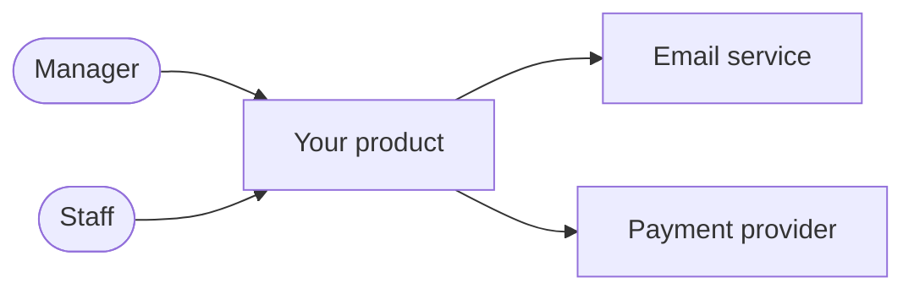
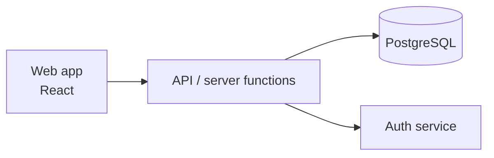
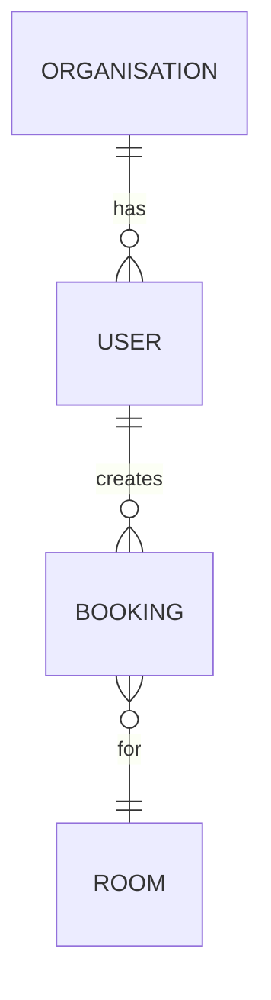

# 04 — Architecture

**Due:** stack decision with Checkpoint 2 (12 Nov) · complete with Checkpoint 3 (26 Nov)
**Practised in:** Session 2 (14 Nov)

## Tech stack
| Layer | Choice | Why |
|---|---|---|
| Build tool | [Lovable / Cursor / Claude Code / Codex] | |
| Front end | [React / Next.js] | |
| Back end / API | | |
| Database | [PostgreSQL via Supabase / Neon / …] | |
| Authentication | | |
| Hosting | | |
| External services / APIs | | |

## System context (C4 level 1)
Who uses the system and which external systems it talks to.

## Containers (C4 level 2)
The main technical building blocks.

GitHub renders Mermaid diagrams automatically. Ask your AI tool to update these when the architecture changes.

## Data model

| Table | Purpose | Key fields |
|---|---|---|
| | | |

## Roles and permissions: how they are enforced
| Rule | Where enforced (database policy / server / UI) |
|---|---|
| [e.g. Staff see only their own organisation's data] | [Row-level security policy] |

Permissions shown only in the UI are not enforced. Every rule needs a backend or database check.

## Security and data protection
- [ ] No secrets in the repository; all listed in `.env.example`
- [ ] Synthetic seed data only
- [ ] Each role tested: can it see or change data it should not?
- Personal data stored: […] · Retention: […]

## Known technical debt and risks
| Item | Impact | Suggested fix for the development team |
|---|---|---|
| | | |
